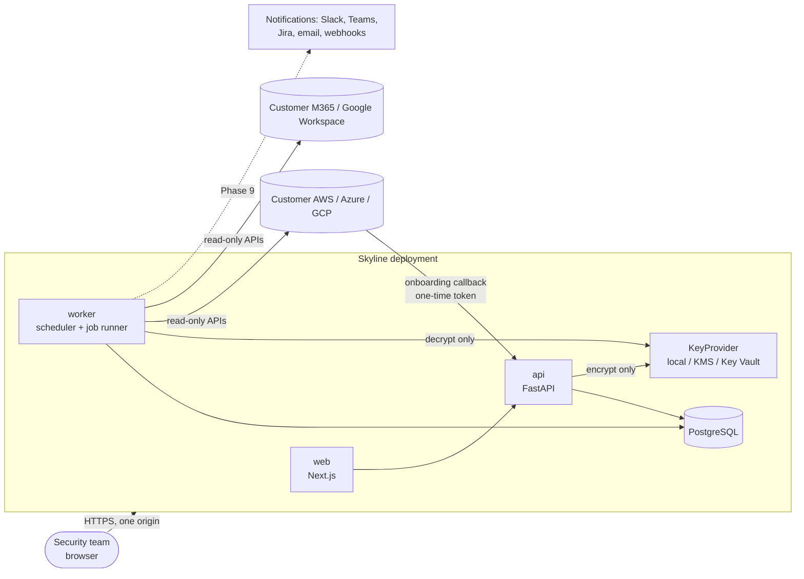
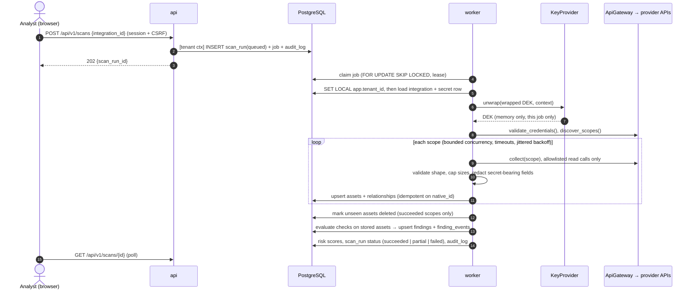
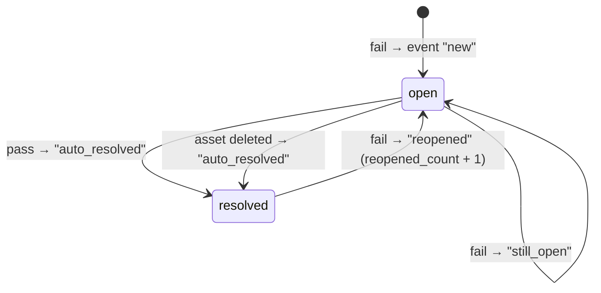
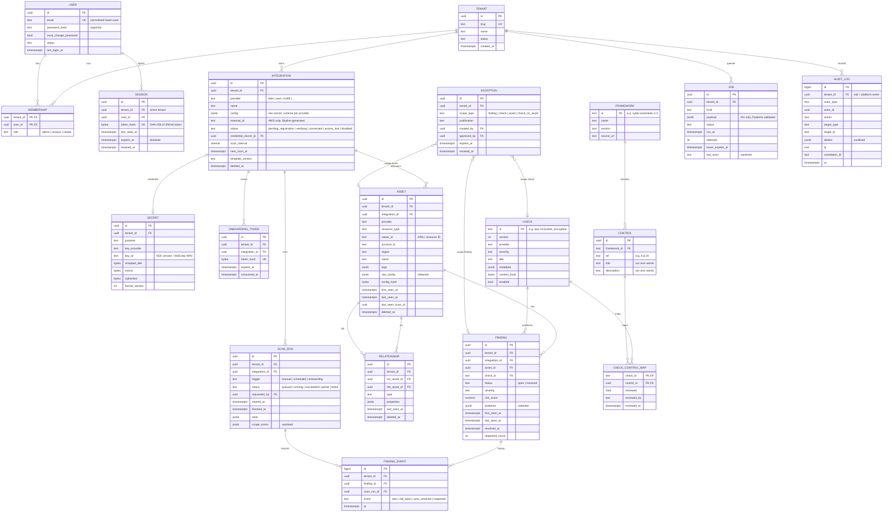
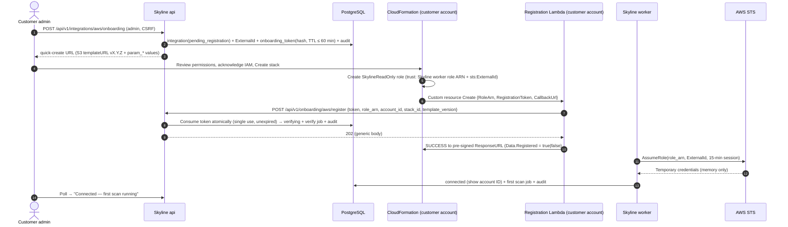
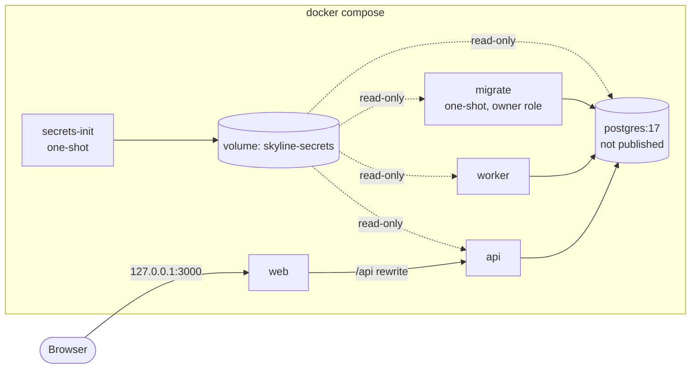
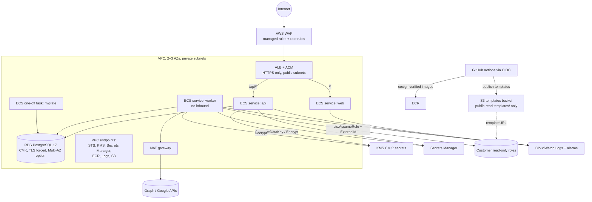

# Skyline — Architecture

Status: **Accepted** for Phase 0 (owner approval 2026-11-23). Source of intent: `docs/PRODUCT_BRIEF.md`.
Rules: `CLAUDE.md`, `docs/SECURE_CODING.md`. Decisions and their reasoning: `docs/adr/`.
Threats and mitigations: `docs/THREAT_MODEL.md`. Delivery plan: `docs/ROADMAP.md`.

This document describes the target architecture. Each section says what Phase 0 builds and
what comes later. Vendor details marked **(verify)** must be checked against official docs, with a
link, in the phase that implements them.

---

## 1. System context



Skyline is **agentless** and **read-only**. Customers grant a read-only identity (AWS
cross-account role, Entra app consent, Google DWD, GCP WIF). Skyline collects configuration,
stores a redacted copy, evaluates checks against what it stored, and shows prioritised findings
mapped to compliance controls.

## 2. Components

| Component | Responsibility | Identity / privileges | Phase |
|---|---|---|---|
| `apps/web` | Next.js UI: login, dashboard, findings, assets, integrations, onboarding wizards. Renders on the client. The Next.js server does no data fetching, only the CSP-nonce middleware and the app shell | None. Talks only to the API on the same origin | 0 |
| `apps/api` | REST `/api/v1`, sessions, RBAC, tenancy, integrations CRUD, scan triggers, findings/assets queries, exceptions, audit log, onboarding endpoints | DB role `skyline_api`. KeyProvider **encrypt-only**. Holds no cloud credentials and never assumes customer roles | 0 |
| `apps/worker` | Scheduler (leader-elected), job runner, connector runners, check engine, lifecycle, risk scorer. Later: graph rules, notifiers, exporters | DB role `skyline_worker`. KeyProvider **decrypt-only**. The cloud identity customers trust (§16.4) | 0 |
| `migrate` (one-off) | Alembic migrations, check/framework catalogue sync, bootstrap tenant + admin | DB role `skyline_owner`. Runs before each deploy, never long-lived | 0 |
| PostgreSQL 17 | All state: tenants, users, integrations, encrypted secrets, assets (nodes), relationships (edges), findings, jobs, audit log. RLS per tenant | — | 0 |
| KeyProvider | Wraps and unwraps data keys for envelope encryption | Local KEK file (dev / single VM), AWS KMS, Azure Key Vault, GCP KMS | 0 local, 4 cloud |
| Collector sidecars | Optional out-of-process collectors, e.g. an Exchange Online PowerShell container. They talk to the worker over a typed local interface | Same constraints as connectors | 2 |
| Onboarding templates | Versioned CloudFormation/Terraform/ARM artefacts and the permissions preview, all rendered from one policy source | Published by the release pipeline only | 1 |

### Package layout and dependency direction

```
packages/core        ← no Skyline imports (settings, logging/redaction, db, tenancy, crypto, audit, models)
packages/connectors  ← core           (Connector protocol, ApiGateway, providers: fake, aws, …)
packages/checks      ← core           (schema, loader, registry, engine, definitions/, evaluators/)
packages/frameworks  ← core           (catalogues/, mappings/, loader, integrity checks)
apps/worker          ← core, connectors, checks, frameworks
apps/api             ← core, checks (metadata only), frameworks
```

Packages never import apps. Connectors never import checks: they only produce records.
`apps/api` cannot import provider SDKs (enforced by an import-linter-style test), which keeps the
API identity free of collection code.

## 3. Scan data flow



Rules that keep findings correct:

- **Collect once, evaluate many.** Checks read stored, redacted data. An `evaluate` job can re-run
  all checks without calling providers again.
- **Partial failure is isolated.** A failed scope (region, subscription, OU) is recorded in
  `scan_runs.scope_errors` with a sanitised reason. Its assets are **not** marked deleted and its
  findings are **not** resolved. If any scope fails, the scan status is `partial`.
- **`error` and `not_applicable` never resolve a finding.** Only an explicit `pass` does.
- **Idempotent and resumable.** Upserts key on `(tenant_id, integration_id, native_id)`. A retried
  job re-runs the scan safely, and the lifecycle is keyed to `scan_run_id`.

### Finding lifecycle



"Muted" is not a stored status. It is computed at query time as *open + an active exception
(not revoked, `expires_at > now()`)*. Mutes therefore expire without a cron job, and expiry
cannot leave stale state behind. Exceptions carry a justification, an approver and a mandatory
expiry (≤ 365 days). Creating or revoking one is audit-logged.

### Risk score (v0 heuristic, Phase 0)

`risk = severity_weight × exposure × sensitivity`. Severity weights: critical 10, high 7, medium
4, low 1, info 0. Exposure is 1.5 if the asset is internet-facing, else 1.0. Sensitivity is 1.3
if the asset is tagged sensitive or prod, else 1.0. Phase 7 replaces this with graph-derived
exposure, privilege reach and toxic combinations (brief §6).

## 4. Data model

Global tables (no `tenant_id`): `tenants`, `users`, `login_attempts`, `checks`, `frameworks`,
`controls`, `check_control_map`. Every other table is **tenant-owned**: it has a `tenant_id NOT
NULL` and an RLS policy (§8).



Notes:

- Indexes: `assets (tenant_id, integration_id, native_id)` unique; `findings (tenant_id, asset_id,
  check_id)` unique; `relationships (tenant_id, src_asset_id)` and `(tenant_id, dst_asset_id)`;
  `findings (tenant_id, status, severity)`; partial unique `jobs (integration_id) WHERE kind='scan'
  AND status IN ('queued','running')`, which allows one active scan per integration.
- Asset history: Phase 0 stores `first_seen_at`, `last_seen_at`, `config_hash` and `deleted_at`.
  Phase 9 adds an `asset_versions` table for config diffs ("what changed since yesterday").
- Roles are a code enum in Phase 0. A custom-role table can come later via an ADR.
  `notification_rules` arrives in Phase 9.
- `login_attempts` is global because it is pre-authentication. It is keyed by an HMAC of the
  normalised email and by IP, and is reachable only through `SECURITY DEFINER` functions (§8).

## 5. Connector plugin interface

Connectors live in `packages/connectors/src/skyline_connectors/<provider>/`. They are registered
in a **static registry** keyed by provider name. Nothing is imported dynamically from DB or YAML
strings. Third-party plugin loading via entry points would need its own ADR.

```python
# packages/connectors/src/skyline_connectors/base.py  (signatures — implementation in Phase 0)
from collections.abc import AsyncIterator, Mapping, Sequence
from dataclasses import dataclass
from typing import ClassVar, Literal, Protocol

from pydantic import BaseModel

JSON = str | int | float | bool | None | Mapping[str, "JSON"] | Sequence["JSON"]


@dataclass(frozen=True, slots=True)
class ApiCall:
    """One provider API operation, e.g. ApiCall("ec2", "DescribeInstances")
    or ApiCall("graph", "GET /v1.0/users")."""
    service: str
    operation: str


@dataclass(frozen=True, slots=True)
class Scope:
    kind: Literal["account", "region", "organization", "org_unit",
                  "subscription", "project", "tenant", "domain"]
    id: str
    parent_id: str | None = None


@dataclass(frozen=True, slots=True)
class AssetRecord:
    resource_type: str             # "aws.ec2.instance", "fake.storage.bucket", …
    native_id: str                 # ARN / provider ID — stable identity
    name: str | None
    account_id: str | None
    region: str | None
    tags: Mapping[str, str]
    raw_config: Mapping[str, JSON] # redacted by the runner before storage
    scope_id: str


@dataclass(frozen=True, slots=True)
class RelationshipRecord:
    src_native_id: str
    dst_native_id: str
    type: str                      # "attached_to", "assumes", "member_of", "exposes", …
    properties: Mapping[str, JSON]


class ValidationResult(BaseModel, extra="forbid"):
    ok: bool
    identity: str | None = None             # e.g. assumed-role ARN, tenant ID
    missing_permissions: list[str] = []
    detail: str = ""                         # sanitised, safe to show to users


class ApiGateway(Protocol):
    """The ONLY way a connector reaches a provider. Denies any ApiCall not in the
    connector's allowlist (raises ApiNotAllowedError), applies timeouts, retry with
    jittered backoff, throttling (Retry-After), pagination caps and response-size caps."""
    async def call(self, api: ApiCall, /, **params: JSON) -> Mapping[str, JSON]: ...
    def paginate(self, api: ApiCall, /, **params: JSON) -> AsyncIterator[Mapping[str, JSON]]: ...


class Connector(Protocol):
    provider: ClassVar[str]
    api_allowlist: ClassVar[frozenset[ApiCall]]
    config_model: ClassVar[type[BaseModel]]       # non-secret integration config
    credential_model: ClassVar[type[BaseModel]]   # decrypted only inside the worker

    async def validate_credentials(self) -> ValidationResult: ...
    async def discover_scopes(self) -> Sequence[Scope]: ...
    def collect(self, scope: Scope) -> AsyncIterator[AssetRecord | RelationshipRecord]: ...


class ConnectorFactory(Protocol):
    def __call__(self, *, config: BaseModel, credentials: BaseModel,
                 gateway: ApiGateway) -> Connector: ...
```

**Read-only enforcement** (ADR-0005), from outermost to innermost:

1. The onboarding role grants only read permissions, plus explicit denies on data-plane reads.
2. Every allowlist entry is validated at import time against the provider's read-only pattern:
   AWS operation names must start with `Describe`, `List` or `Get`; HTTP connectors allow `GET`
   only, plus a named, reviewed list of read-only `POST`s such as query endpoints (each one needs
   an ADR note).
3. At runtime the `ApiGateway` refuses any call outside the allowlist.
4. In tests, each connector runs against its fixtures with a recording gateway, and the build
   fails if it makes any undeclared call. A deliberately rogue test connector must be rejected.
   An AST test forbids importing provider SDKs or HTTP clients in connector modules outside the
   gateway adapter.
5. From Phase 1, a boto3 `before-call` event hook applies the same allowlist inside the SDK
   (verify event names).

The **`fake` connector** (Phase 0) yields a deterministic small company. Each item below is
followed by the check it should trigger:

- a public VM on an end-of-life OS → `public_vm`, `unsupported_os`
- a private VM → passes
- a security group open on 22 and 3389 to `0.0.0.0/0` → `sg_admin_ports_open`
- a tight security group → passes
- an unencrypted bucket → `bucket_encryption`
- an encrypted bucket → passes
- an admin user without MFA → `admin_without_mfa`
- a user with MFA → passes
- edges: VM→SG, VM→role, user→role

The non-secret config `simulate_fixes: [...]` flips individual resources to their fixed state,
so you can demonstrate auto-resolve from the UI.

## 6. Check engine

```
packages/checks/src/skyline_checks/
  schema.py        Pydantic models for check YAML (extra="forbid")
  loader.py        yaml.safe_load + validation + id uniqueness + version bump on content change
  registry.py      @evaluator("check.id") decorator; YAML never names an import path
  engine.py        selects checks by provider/resource_type, runs evaluators, isolates errors
  definitions/<provider>/*.yaml
  evaluators/<provider>.py
packages/checks/tests/fixtures/<check_id>/{pass,fail}.json
```

```yaml
# definitions/fake/sg_admin_ports_open.yaml (illustrative)
id: fake.network.sg_admin_ports_open
version: 1
title: Security group allows administrative ports from the internet
severity: high
provider: fake
resource_types: [fake.network.security_group]
evaluator: python            # later: rego | cel | graph
description: >-
  Inbound rules allow SSH (22) or RDP (3389) from any IPv4/IPv6 address.
rationale: >-
  Internet-reachable admin ports are a common initial-access path.
remediation:
  summary: Restrict admin ports to known networks or use a bastion/session manager.
  steps:
    - Remove 0.0.0.0/0 and ::/0 sources from rules on ports 22 and 3389.
references:
  - title: Example vendor guidance (real URL added when the provider check is written)
    url: https://example.com
tags: [network, exposure]
```

```python
class Status(StrEnum): PASS = "pass"; FAIL = "fail"; ERROR = "error"; NOT_APPLICABLE = "not_applicable"

@dataclass(frozen=True, slots=True)
class Result:
    status: Status
    evidence: Mapping[str, JSON]   # small, redacted, human-readable facts

class EvalContext(Protocol):
    """Read-only view for an evaluator: related assets via the graph, tenant settings."""
    def related(self, asset: AssetView, rel_type: str, direction: Literal["out", "in"]) -> Sequence[AssetView]: ...

Evaluator = Callable[[AssetView, EvalContext], Result]   # pure, no I/O
```

- Evaluators are pure functions with no network or DB writes. The engine catches exceptions, and
  a crashing evaluator yields `error` for that asset only.
- A parametrised test enforces that **every check has `pass.json` and `fail.json` fixtures** and
  that they produce `pass` and `fail` respectively. Adding a check needs no changes outside
  `packages/checks/` (brief §10).
- At migrate time, check metadata is synced into the global `checks` table, and the API reads it
  from there. `content_hash` detects edits, and a changed definition must bump its `version`.
- Other evaluator types (Rego/CEL, graph queries) plug in behind the same `Result` contract.

## 7. Compliance frameworks

```
packages/frameworks/src/skyline_frameworks/
  catalogues/cyber-essentials-3.3.yaml   controls: our IDs + our own short wording + source URL
  catalogues/iso27001-2022.yaml          controls: Annex A refs (e.g. A.8.20) + our own wording
  mappings/cyber-essentials-3.3.yaml     check_id → [control refs], reviewed: false
  mappings/iso27001-2022.yaml
```

- Cyber Essentials has no official control numbering. Skyline uses `CE.FW`, `CE.SC`, `CE.SUM`,
  `CE.UAC` and `CE.MP` for the five technical controls in *Requirements for IT Infrastructure
  v3.3* (NCSC, in force from 27 April 2026):
  https://www.ncsc.gov.uk/cyberessentials/resources.
- ISO/IEC 27001:2022 Annex A uses its control reference numbers (5.x organisational, 6.x people,
  7.x physical, 8.x technological) with descriptions written in our own words. No ISO or CIS text
  is reproduced: https://www.iso.org/standard/27001.
- Every mapping starts as `reviewed: false`. Phase 5 adds the admin review workflow.
- Integrity tests: every mapped check exists, every mapped control exists in its catalogue, and
  the list of unmapped checks is reported, not hidden.

## 8. Tenancy model

- **Shared schema with a `tenant_id` column.** Every tenant-owned table has `ENABLE ROW LEVEL
  SECURITY` and `FORCE ROW LEVEL SECURITY` with:

  ```sql
  USING      (tenant_id = NULLIF(current_setting('app.tenant_id', true), '')::uuid)
  WITH CHECK (tenant_id = NULLIF(current_setting('app.tenant_id', true), '')::uuid)
  ```

  If the setting is unset, the policy compares against `NULL`, so it **fails closed** and returns
  zero rows.
- The app sets the tenant **per transaction** with `SELECT set_config('app.tenant_id', :tid,
  true)` as a bound parameter. The setting is transaction-scoped, so a pooled connection can't
  carry it into another request.
- **Database roles.** None has `BYPASSRLS`, and none of the app roles owns the tables:

  | Role | Used by | Grants |
  |---|---|---|
  | `skyline_owner` | migrate | Owns schema; DDL |
  | `skyline_api` | api | DML on tenant tables; **INSERT-only** on `secrets` (no SELECT on `wrapped_dek`/`ciphertext`); INSERT+SELECT on `audit_log`; INSERT on `jobs` |
  | `skyline_worker` | worker | DML on tenant tables; SELECT on `secrets`; claim/update on `jobs` via a role-specific policy; INSERT+SELECT on `audit_log` |

- **Pre-tenant lookups** happen only through narrow `SECURITY DEFINER` functions owned by
  `skyline_owner`, each with `SET search_path = pg_catalog, skyline`. They cover authenticating a
  user by email, resolving a session by token hash, consuming an onboarding token, and listing
  due integrations for the scheduler. Each returns the minimum columns needed. See
  https://www.postgresql.org/docs/current/sql-createfunction.html.
- **Application scoping on top of RLS.** Repositories always filter by `tenant_id` explicitly.
  RLS is the backstop, not the only control.
- **Users are global and memberships are per tenant**, so one person can belong to many tenants
  later (MSP and SaaS mode) without a schema change. Single-tenant self-host mode creates one
  `default` tenant at bootstrap. Multi-tenant mode (Phase 9) adds tenant signup, per-tenant KMS
  data keys and per-tenant rate limits.
- **Tests:** tenant A can't SELECT, UPDATE, DELETE or INSERT tenant B's rows by ID. Any query with
  no tenant set returns 0 rows. Every resource endpoint has an IDOR test.

## 9. Authentication, sessions and authorisation

- **Opaque server-side sessions** (ADR-0008). Login creates a 256-bit random token, sent in the
  cookie `__Host-skyline_session` (HttpOnly, Secure, **SameSite=Lax**, Path=/). Only its SHA-256
  hash is stored. Sessions have a 30-minute idle timeout and a 12-hour absolute timeout. Logout
  (POST) revokes the session, and a password change revokes all of the user's sessions.
- **Why Lax:** notification links from Slack, Teams and Jira are cross-site top-level GETs and
  must open the user's session. The consequences:
  - GET/HEAD **never** change state. A test enumerates routes and asserts that every
    state-changing route is POST, PUT, PATCH or DELETE.
  - CSRF is double-submit: the cookie `__Host-skyline_csrf` must match the `X-CSRF-Token` header,
    and the token is HMAC-bound to the session.
  - Unsafe methods also need a matching `Origin` header, and requests with
    `Sec-Fetch-Site: cross-site` are rejected.
  - After login, the `next` redirect accepts only same-origin relative paths (it rejects `//`,
    `/\`, schemes and encoded variants), so deep links can't become open redirects.
- **Passwords:** argon2id (argon2-cffi defaults), at least 12 characters (1,024-character cap as a
  DoS guard only), a common-password blocklist,
  and verification against a dummy hash when the user doesn't exist so timing reveals nothing.
  Login errors are always generic. Throttling is stored in Postgres per account and per IP, so
  it works across replicas, and returns `429` with `Retry-After`. Failures are audit-logged. The
  bootstrap admin must change their password on first login.
- **RBAC.** Deny by default: every route declares `Depends(require(Permission.X))`. A test fails
  if any route lacks a permission, except the explicit public set: `/healthz`, `/readyz`,
  `POST /api/v1/auth/login` and the onboarding registration callbacks, which use their own token
  auth.

  | Permission | admin | analyst | viewer |
  |---|:-:|:-:|:-:|
  | `findings:read`, `assets:read`, `frameworks:read`, `integrations:read` | ✓ | ✓ | ✓ |
  | `scans:run` | ✓ | ✓ | |
  | `integrations:write`, `onboarding:start` | ✓ | | |
  | `exceptions:write` (create/revoke mute; approver = creator until Phase 5 workflow) | ✓ | | |
  | `audit:read`, `users:manage` | ✓ | | |

- **Same origin:** the browser only talks to the web origin, and `/api/*` is routed to the API.
  Locally that's a Next.js rewrite; in production it's an ALB or Ingress path rule. No CORS is
  configured. OIDC SSO (Entra ID, Google) and API tokens come in Phase 9.

## 10. Secrets and KeyProvider (envelope encryption)

```python
@dataclass(frozen=True, slots=True)
class EncryptionContext:
    tenant_id: UUID
    secret_id: UUID
    purpose: str                    # "integration_credential", "redaction_hmac_key", …
    def aad(self) -> bytes: ...     # canonical, versioned encoding

@dataclass(slots=True)
class DataKey:
    plaintext: bytearray            # zeroed (best effort) after use
    wrapped: bytes
    key_id: str                     # local KEK version or KMS key ARN

class KeyProvider(Protocol):
    name: ClassVar[str]             # "local" | "aws-kms" | "azure-keyvault" | "gcp-kms"
    async def generate_data_key(self, ctx: EncryptionContext) -> DataKey: ...
    async def unwrap(self, wrapped: bytes, key_id: str, ctx: EncryptionContext) -> bytearray: ...

class SecretBox:
    """seal(plaintext, ctx) -> SealedSecret; open(sealed, ctx) -> bytes.
    AES-256-GCM via `cryptography`, a fresh DEK and a fresh random 96-bit nonce per secret,
    AAD = ctx.aad() so a ciphertext can't be moved to another tenant/secret/purpose."""
```

- **Local provider:** the KEK is 32 random bytes read from a file (`SKYLINE_LOCAL_KEK_FILE`)
  that is generated once by `secrets-init` and never committed. It supports several versioned
  KEKs (`key_id`) at once: the active one wraps new keys and old ones still unwrap. Rotation
  re-wraps DEKs only.
- **KMS providers (Phase 4):** AWS KMS `GenerateDataKey` / `Decrypt` with an encryption context
  of `tenant_id`, `purpose` and `secret_id`, and key-policy conditions on that context. The API
  gets `GenerateDataKey` / `Encrypt` only; the worker gets `Decrypt` only. Key Vault and GCP KMS
  follow the same split. See https://docs.aws.amazon.com/kms/latest/developerguide/encrypt_context.html.
- Plaintext credentials exist only in worker memory for one job, wrapped in a `Secret[T]` type
  whose `repr` and `str` print `***`. They never go to logs, errors or the API.
- **Raw-config redaction** happens before storage, using per-provider rules (EC2 user data,
  Lambda and container environment variables, connection strings and so on). Each redacted value
  is replaced with `{"redacted": true, "hmac": "<HMAC-SHA256 with a per-tenant key>"}`. That still
  detects changes, but unlike a bare hash, low-entropy secrets can't be guessed offline.
- **Log redaction:** a shared structlog processor drops or masks values by key (password, secret,
  token, authorization, cookie, key, credential, user_data, env…) and by value pattern (PEM
  blocks, AWS access key IDs, JWT-shaped strings, bearer tokens). Negative tests prove it.

## 11. Job queue and scheduler

- A `JobQueue` interface (`enqueue`, `claim`, `heartbeat`, `complete`, `fail`) with a Postgres
  implementation (ADR-0003). Claiming uses `UPDATE … WHERE id = (SELECT id … FOR UPDATE SKIP
  LOCKED LIMIT 1) RETURNING`, built with SQLAlchemy expressions. Jobs hold a lease
  (`lease_expires_at`) that heartbeats extend, and a reaper re-queues jobs with expired leases.
  Retries back off exponentially with jitter up to `max_attempts`.
- Payloads are JSON with **IDs only**, validated by a Pydantic model per `kind`. No pickling.
- The scheduler runs inside the worker and is leader-elected with `pg_try_advisory_lock`. It
  calls the `SECURITY DEFINER` function `skyline_due_integrations()`, which returns `(tenant_id,
  integration_id)` pairs only, and enqueues scans. A partial unique index stops duplicate active
  scans for the same integration.
- Job kinds: `scan`, `evaluate`, `verify_integration` (onboarding and test-connection) and, later,
  `notify` and `export`.
- Redis or SQS can replace the queue behind the same interface if load ever requires it.

## 12. Customer onboarding (brief §3a, ADR-0011)

The bar: **connect in under 5 minutes, in a few clicks, with no ARNs or secrets copy-pasted, and
see exactly what is being granted.**

### 12.1 Provider-agnostic flow

```python
class OnboardingSession(BaseModel, extra="forbid"):
    integration_id: UUID
    launch_url: str | None              # CFN quick-create, admin-consent link, Deploy-to-Azure …
    artifacts: list[OnboardingArtifact] # versioned template/module links + SHA-256
    permissions_preview: PermissionsPreview
    expires_at: datetime

class OnboardingFlow(Protocol):
    provider: ClassVar[str]
    async def start(self, tenant_id: UUID, integration_id: UUID) -> OnboardingSession: ...
    async def register(self, payload: BaseModel) -> RegistrationOutcome: ...  # callback or user input
    async def verify(self, integration_id: UUID) -> ValidationResult: ...     # runs in the worker
```

Integration states: `pending_registration → verifying → connected`, then `access_lost` (failed
re-verification) or `disabled`. A callback **never** connects an integration on its own: it can
only move it to `verifying`. The worker proves access before marking it `connected`.

### 12.2 AWS single account: Launch Stack with auto-registration



- **ExternalId** is generated by Skyline (≥ 128 bits of entropy), unique per integration, and
  never editable by the user. This is the confused-deputy defence:
  https://docs.aws.amazon.com/IAM/latest/UserGuide/confused-deputy.html.
- **Quick-create link:** `templateURL` must point to S3, and parameters are passed as
  `param_<Name>`. CloudFormation **skips `NoEcho` parameters** in quick-create links, so the
  registration token travels as a **normal parameter**. It is visible in the stack's parameters
  and in browser history.
  - **Mitigation:** the token is 256-bit, single-use, valid for at most 60 minutes, stored only
    as a SHA-256 hash, bound to tenant + integration, and worthless once consumed. On its own it
    can't connect anything, because the worker must still succeed at `AssumeRole` with the
    integration's ExternalId.
  - This is an exception to the "no secrets in URLs" rule, recorded in ADR-0011.
  - Source: https://docs.aws.amazon.com/AWSCloudFormation/latest/UserGuide/cfn-console-create-stacks-quick-create-links.html
- **Role:** trusts the **specific Skyline worker role ARN**, not the whole account root, with an
  `sts:ExternalId` condition. Permissions: AWS-managed `SecurityAudit` + `ViewOnlyAccess`, or a
  tighter custom policy (decided in Phase 1, verify). It also carries **explicit denies on
  data-plane reads**: `s3:GetObject`, `secretsmanager:GetSecretValue`, `ssm:GetParameter*`,
  `kms:Decrypt`, DynamoDB item reads and similar (exact list in Phase 1, verify), plus a maximum
  session duration of 1 hour. Role path `/skyline/` and a tag `skyline:template-version`.
- **Registration Lambda:** inline code (no dependencies, readable in the template), a logs-only
  execution role, HTTPS with certificate verification, a short timeout.
  - It **always** reports `SUCCESS` to CloudFormation so the customer's stack never hangs or rolls
    back because Skyline is unreachable. A `RegistrationStatus` stack output tells the user
    whether to fall back to pasting the role ARN.
  - On Update or Delete events it only *notifies* Skyline, which then re-verifies access. It never
    disconnects blindly.
  - Custom resource contract: https://docs.aws.amazon.com/AWSCloudFormation/latest/UserGuide/crpg-ref.html.
- **Callback endpoint** `POST /api/v1/onboarding/aws/register`:
  - Authentication: no session and no CSRF; it is in the explicit public-route allowlist with a
    token-auth dependency. The token is compared in constant time.
  - Input validation: strict Pydantic schema (`extra="forbid"`) and a body limit of about 8 KB.
    The role ARN must match `^arn:(aws|aws-us-gov|aws-cn):iam::\d{12}:role/skyline/[\w+=,.@-]{1,64}$`
    (path and partitions finalised in Phase 1), and the account ID must match the ARN.
  - Abuse handling: generic `202` responses whether or not the token exists; per-IP and global
    rate limits (plus a WAF rate rule in the AWS deployment); every attempt, successful or not,
    is audit-logged.
  - This path must be reachable from the internet even when the UI is restricted (§16.4).
- **Fallbacks:** paste the role ARN (needed for self-hosted Skyline that AWS can't reach), or the
  Terraform module.

### 12.3 AWS organisation: StackSets

- The customer launches one **management-account** quick-create stack. It creates:
  1. A read-only role in the management account, plus `organizations:List*` / `Describe*` for
     member discovery.
  2. A **service-managed `AWS::CloudFormation::StackSet`** with automatic deployment enabled,
     targeting chosen OUs (root by default). It deploys the member-account read-only role with
     the same role path and name and the org integration's ExternalId.
  3. The registration custom resource.
- Prerequisites and limits: trusted access between StackSets and Organizations must be enabled
  (the wizard checks for it and explains it). Service-managed StackSets **never deploy to the
  management account**, which is why step 1 creates that role directly.
  https://docs.aws.amazon.com/AWSCloudFormation/latest/UserGuide/stacksets-orgs-associate-stackset-with-org.html
- **Members are discovered, not self-registered.** The worker lists the org's accounts through
  the management role and assumes `/skyline/<RoleName>` in each one with the ExternalId. Accounts
  where the role isn't there yet show "role missing" or "pending deploy". No long-lived,
  multi-use registration tokens exist. Auto-deployment covers new accounts; accounts already in
  an OU are deployed by the initial StackSet operation.

### 12.4 One source for permissions, versioned templates

- The policy JSON in `deploy/onboarding/aws/policy/` (read-only actions, explicit denies, trust
  policy shape) is the **single source**. A generator renders the CloudFormation templates, the
  Terraform module (`deploy/terraform/onboarding/aws/`) and the UI's **permissions preview**.
  CI regenerates them and fails on drift.
- Templates are semver-versioned and immutable once published. They're hosted in the operator's
  templates bucket (§16.4) at `templates/aws/vX.Y.Z/…`, with their SHA-256 shown in the UI and the
  release notes. The connector reads `skyline:template-version` from the role's tags (a read-only
  call) and the UI offers an "update stack" link when a newer version exists.
- CI lints and scans every template: cfn-lint, checkov or Trivy config, and `terraform validate`.
- Optional higher-privilege add-ons (snapshot scanning in Phase 8, DSPM in Phase 16, opt-in
  remediation in Phase 19) are **separate templates**. The base role stays read-only.

### 12.5 Other providers (design intent, built in their phases)

| Provider | One-click path | Notes |
|---|---|---|
| Microsoft 365 / Entra (Phase 2) | Skyline is a **multi-tenant Entra app**. The customer clicks the admin-consent link, with `state` bound to the session (CSRF), then Skyline verifies by acquiring an app-only token for that tenant | The client-assertion signing key stays in **KMS / Key Vault (sign operation)** and never leaves the HSM. Self-hosters register their own app with a guided script. Exchange Online PowerShell collector container where Graph lacks coverage |
| Google Workspace (Phase 3) | Wizard with copy buttons for the client ID and exact `*.readonly` scope list, then test connection | DWD warning explaining scope and impersonated admin. Investigate a Marketplace app |
| Azure (Phase 6) | Deploy-to-Azure / Cloud Shell one-liner: app registration + Reader + Security Reader at management-group scope, plus admin consent | Certificate or WIF credentials, never client secrets |
| GCP (Phase 6) | Cloud Shell one-liner / Terraform: WIF pool or service account with `roles/viewer` + `roles/iam.securityReviewer` at org/folder | Key-based service account only as a last resort, encrypted |

Each flow gets a permissions-preview page, a fixture-based end-to-end test in CI and a manual
sandbox end-to-end test (run only with the owner's approval).

## 13. API surface (Phase 0)

`/healthz` (liveness) and `/readyz` (DB reachable, migrations at head) are unauthenticated and
return nothing sensitive. Under `/api/v1`:

- `auth/login`, `auth/logout`, `auth/me`, `auth/change-password`
- `integrations` (CRUD) and `integrations/{id}/test` (enqueues `verify_integration`)
- `scans` (POST to trigger, GET list) and `scans/{id}`
- `assets` and `assets/{id}`
- `findings?severity=&provider=&framework=&status=&check_id=`, `findings/{id}`, `findings/summary`
- `exceptions` (POST, GET) and `exceptions/{id}/revoke` (POST)
- `audit-log`
- `checks`, `frameworks`, `frameworks/{id}/controls`

Lists use capped pagination (`limit ≤ 200`). Errors follow one shape:
`{"error": {"code", "message", "correlation_id"}}`, with a generic message and no stack traces,
SQL or paths. Every response carries `Cache-Control: no-store`, `X-Content-Type-Options: nosniff`
and `Referrer-Policy: no-referrer`. OpenAPI docs are on only when `SKYLINE_ENV=development`.

## 14. Web application

- Next.js App Router with TypeScript strict, Tailwind, shadcn/ui, and TanStack Query/Table.
  Data is fetched on the client from `/api/v1`. There is no server-side fetching of
  user-controlled URLs.
- Per-request **nonce CSP** set by middleware: `default-src 'self'; script-src 'self'
  'nonce-…' 'strict-dynamic'; object-src 'none'; base-uri 'none'; frame-ancestors 'none';
  form-action 'self'`. `style-src-attr 'unsafe-inline'` is allowed only if the Radix positioning
  styles need it, and the reason is documented. HSTS is sent wherever TLS terminates.
- Data from customer resources (names, tags, evidence) is **hostile input**. It is rendered only
  through React escaping, `dangerouslySetInnerHTML` is never used, and links built from resource
  data are restricted to `https:` with an allowlist.
- Pages:
  - login and forced password change, with a safe `next` deep-link return
  - dashboard: counts by severity, top risks
  - findings: table with filters, and a drawer showing evidence, remediation, framework mappings
    and the mute action
  - assets
  - integrations: add fake integration, scan, status, simulate fix
  - from Phase 1, onboarding wizards

## 15. Observability

- Structured JSON logs (structlog) through the shared redaction processor. Each log line carries
  a `correlation_id`, generated server-side; a client-supplied `X-Request-ID` is accepted only if
  it's a valid UUID. No request bodies, `Authorization` headers, cookies or raw resource config
  are logged.
- **Audit log** (DB) records security events: login success and failure, permission denied,
  integration created or changed, onboarding token issued or consumed, scan requested, exception
  created or revoked, password changed, bootstrap. App roles get INSERT + SELECT only. Hash
  chaining for tamper evidence is a Phase 9 hardening item.
- Metrics (Phase 4): scan duration and per-scope failures, queue depth, API latency and 5xx,
  login failures, onboarding conversions.

## 16. Deployment topology

The same container images are used everywhere. Configuration is 12-factor (environment variables,
with `*_FILE` variants for secrets), and no cloud-specific service is required.

### 16.1 Local and single VM: Docker Compose



- **`secrets-init`** creates, if they're missing: the local KEK, the passwords for the three DB
  roles, the session/CSRF HMAC key and a bootstrap admin password. They go into a named volume,
  are never printed and are mounted read-only into the services that need them. The README shows
  the one command to read the bootstrap password. First login forces a password change.
- Containers are non-root, have a read-only root filesystem with a tmpfs `/tmp`, `cap_drop: [ALL]`
  and `security_opt: no-new-privileges`, use digest-pinned bases and have HEALTHCHECKs. Only
  `web` is published, on `127.0.0.1`.
- **Single VM (Phase 4):** the same file plus Caddy (automatic TLS) as the only published service
  on 443, and a backup script (encrypted `pg_dump`).

### 16.2 Kubernetes: Helm (Phase 4)

`deploy/helm/skyline` contains:

- Deployments for web, api and worker, with an HPA for workers.
- A `migrate` Job run as a pre-install/pre-upgrade hook.
- External Postgres, and secrets from an existing Secret or the CSI Secrets Store driver.
- Ingress path routing (`/api` → api).
- NetworkPolicies (default deny, explicit egress for the worker), Pod Security `restricted`, and
  separate ServiceAccounts for api and worker, mapped to IRSA / EKS Pod Identity, AKS workload
  identity or GKE workload identity.

### 16.3 Terraform hosting modules (Phase 4)

`deploy/terraform/hosting/{aws,azure,gcp}`, plus the AWS CloudFormation equivalent (§16.4).

| Concern | AWS (reference) | Azure | GCP |
|---|---|---|---|
| Compute | ECS Fargate (EKS + Helm alternative) | Container Apps (AKS + Helm) | Cloud Run (GKE + Helm) |
| Postgres | RDS PostgreSQL 17 | Flexible Server | Cloud SQL |
| Envelope KEK | KMS CMK | Key Vault (HSM-backed keys) | Cloud KMS |
| Secrets | Secrets Manager | Key Vault secrets | Secret Manager |
| Edge | ALB + ACM + WAF | Front Door / App Gateway + WAF | HTTPS LB + Cloud Armor |
| Logs | CloudWatch | Log Analytics | Cloud Logging |

### 16.4 Skyline on AWS: reference deployment (brief §9, ADR-0012)



- **Network:** the ALB sits in public subnets; tasks and RDS are in private subnets. The worker
  accepts no inbound traffic. VPC endpoints keep AWS API traffic off the NAT gateway, and the NAT
  is used only for SaaS APIs. Optionally, the ALB can restrict the UI by source IP or VPN while
  `/api/v1/onboarding/*/register` stays reachable.
- **Identities (least privilege):**
  - api task role: KMS `GenerateDataKey` / `Encrypt` on the secrets CMK, plus read access to its
    own Secrets Manager entries.
  - worker task role: KMS `Decrypt`, plus `sts:AssumeRole` on `arn:aws:iam::*:role/skyline/*`.
    That's a documented exception to the no-wildcards rule: customer accounts aren't known in
    advance, and access is still limited by the role path and the per-integration ExternalId.
  - web: no AWS permissions.
  - execution role: ECR pull, logs, and only the specific secrets it needs.
- **The worker role is the principal customers trust.** Never delete or recreate it, because
  trust policies bind to the role's unique ID. Protect it with an SCP or deletion guard, and alarm
  on unusual `AssumeRole` volume in CloudTrail.
- **Data:** RDS encrypted with a CMK, `rds.force_ssl`, automated encrypted backups, deletion
  protection and a Secrets-Manager-managed master password. App roles have their own secrets.
  CMKs for secrets, RDS, logs and S3 are separate, with rotation on.
- **Edge:** HTTPS only, the current recommended TLS policy (verify in Phase 4), AWS managed WAF
  rule groups, and rate-based rules on login and the onboarding callback. ALB access logs go to
  encrypted S3.
- **Supply chain:** CI verifies cosign signatures and SBOMs, then mirrors images to ECR.
  Terraform state lives in KMS-encrypted, versioned S3 with locking. Deploy and publish access
  uses **GitHub OIDC** roles bound to protected environments, so GitHub holds no AWS keys.
- **Upgrades:**
  - Releases are semver.
  - Migrations follow expand/contract, so the previous release keeps working against the new
    schema. The migrate task runs before services update.
  - RDS is snapshotted before every upgrade. Rollback means returning to the previous task
    definition; destructive migrations ship only in a later release.
- **Two IaC formats:** both CloudFormation and Terraform are delivered, as the brief asks.
  Terraform comes first (Phase 4a) and CloudFormation follows (4b). A resource-parity checklist
  test keeps them aligned, and the shared IAM policy documents come from one source.

### 16.5 Cross-cloud identity (no long-lived AWS keys anywhere)

Customer roles always trust one AWS IAM role, the operator's Skyline worker role. How the worker
obtains that role depends on where Skyline runs:

| Skyline runs on | Worker obtains the Skyline AWS role via |
|---|---|
| ECS / EKS | Task role / EKS Pod Identity or IRSA |
| Azure (Container Apps / AKS) | Managed identity token → `sts:AssumeRoleWithWebIdentity` (IAM OIDC provider for the Entra issuer) |
| GCP (Cloud Run / GKE) | Service-account ID token → `sts:AssumeRoleWithWebIdentity` |
| On-prem / other VM | IAM Roles Anywhere (X.509) |
| Local dev | AWS CLI profile (SSO) for a dedicated **sandbox** account only |

Then it chains `sts:AssumeRole` into the customer role with the ExternalId. Role chaining caps
those sessions at 1 hour, which is fine for job-scoped credentials. Microsoft 365, Google
Workspace, Azure and GCP customer access follows the same pattern, using federated or
certificate credentials held by the worker identity.

## 17. How the design meets the non-functional targets

| Target | Approach |
|---|---|
| 1,000-resource AWS account in under 10 minutes | Per-region concurrency, paginated reads, batched upserts (`INSERT … ON CONFLICT`), evaluation in-process against batches; benchmarked in Phase 1 |
| New check without code outside `packages/checks/` | YAML + registered evaluator + fixtures; mappings are data in `packages/frameworks` and optional |
| Offline tests, CI never calls real clouds | Fake connector, `ApiGateway` fakes, moto/recorded fixtures; CI has no cloud credentials and network egress isn't relied on |
| Multi-tenant ready | `tenant_id` + RLS + memberships from day one; per-tenant KMS context |
| Deploy anywhere | One image set; Compose / Helm / Terraform; KeyProvider abstraction; no cloud service required |

## 18. Open items to verify (tracked in ROADMAP phases)

- AWS: exact managed-policy choice versus a custom read-only policy, and the data-plane deny list
  (Phase 1).
- AWS: the quick-create console path, the boto3 event-hook names and the current CIS AWS
  Foundations version (Phase 1).
- Microsoft Graph: least-privilege permission set; which checks need Exchange Online PowerShell
  (Phase 2).
- Google Workspace: scopes, including the Cloud Identity Policy API (Phase 3).
- AWS hosting: ALB TLS policy name, WAF rule groups, RDS parameters (Phase 4).
- Cyber Essentials v3.3 control wording, reviewed against the NCSC PDF before mappings are marked
  reviewed (Phase 5).
