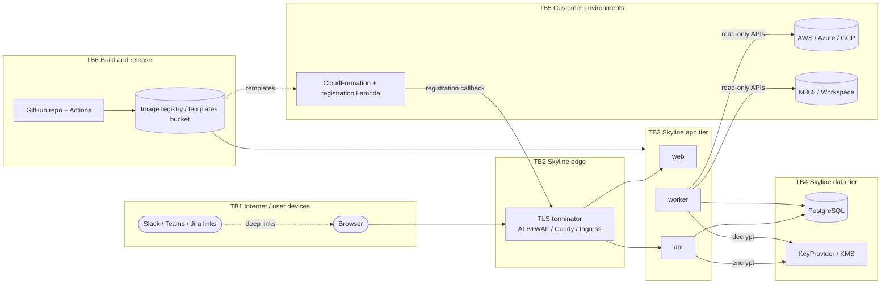

# Skyline — Threat Model (STRIDE)

- Version: 0.1 (Phase 0 design), 2026-11-23
- Owner: project owner. Updated at the start and end of every phase (see §9).
- Method: STRIDE per trust boundary. Each threat has a mitigation tagged with the phase that
  delivers it, and a status: `Designed` (in ARCHITECTURE/ADRs), `Implemented` (code + tests),
  `Verified` (security-reviewer + negative tests passed).

Skyline is a high-value target. One instance holds trusted read access to every connected
customer environment, plus a detailed map of their weaknesses (findings). The design goal is
that no single bug, credential or component compromise gives cross-tenant access, write access
to customer clouds, or plaintext customer credentials.

---

## 1. System and trust boundaries

## 2. Assets to protect

| ID | Asset | Why it matters |
|---|---|---|
| A1 | **Trust relationships into customer environments** (worker role principal, ExternalIds, Entra multi-tenant app signing key, Workspace DWD service account, WIF configs) | Whoever controls them reads every customer environment |
| A2 | Stored integration secrets and the KEK / KMS keys | Unwrapping them yields customer credentials |
| A3 | Collected configuration (raw_config, tags, evidence) | Customer data; may contain secrets if redaction fails |
| A4 | Findings and the asset graph | A ready-made attack plan for each customer |
| A5 | Sessions, password hashes, onboarding/registration tokens | Account takeover, rogue integrations |
| A6 | Audit log | Accountability and incident response |
| A7 | Build, release and deploy pipeline (repo, Actions, images, templates, Terraform state) | A supply-chain compromise reaches every installation |
| A8 | Tenant isolation guarantees | A cross-tenant leak destroys trust in SaaS mode |

## 3. Adversaries

- **E1** Unauthenticated internet attacker (UI, API, onboarding callback).
- **E2** Authenticated low-privilege user (viewer or analyst) trying to escalate privilege or reach
  another tenant.
- **E3** Malicious or compromised tenant in SaaS mode attacking other tenants.
- **E4** Compromised customer cloud or SaaS account returning hostile API data (XSS payloads in
  names or tags, oversized responses, pagination loops).
- **E5** Supply-chain attacker: a malicious dependency or action, or a compromised maintainer
  account.
- **E6** Insider or operator with infrastructure access (DB admin, cloud admin of the Skyline
  account).
- **E7** Someone with a stolen artefact: a DB backup, logs, a laptop, Terraform state.
- **E8** A phisher abusing deep links and redirects.

## 4. Threats and mitigations by boundary

### TB1/TB2: Browser ↔ edge ↔ web/api

| ID | STRIDE | Threat | Mitigations | Phase | Status |
|---|---|---|---|---|---|
| T1.1 | S | Credential stuffing / brute force on login | argon2id; Postgres-backed progressive throttling (waits double from 1 s to a 5-minute temporary lock) plus hard ceilings: ≤ 10 failures in any 5 min per account, and per known device (device cookies are bound to the current password) (CE v3.3), 100 per IP bucket; guesses spaced by the wait even in parallel; generic errors; audit of failures; WAF rate rule in AWS; OIDC SSO + MFA via IdP | 0, 4, 9 | Designed |
| T1.2 | S | Session hijack / fixation | 256-bit opaque token, `__Host-` HttpOnly Secure cookie, hash at rest, new session on login, idle 30 min / absolute 12 h, revoke on logout and password change (ADR-0008) | 0 | Designed |
| T1.3 | T | CSRF, made more likely by `SameSite=Lax` | Safe methods never change state (route test); double-submit CSRF token HMAC-bound to the session; `Origin` check; reject `Sec-Fetch-Site: cross-site` on unsafe methods; login is JSON-only (ADR-0008) | 0 | Designed |
| T1.4 | S/I | Open redirect via `next` on deep links (phishing, E8) | Only same-origin relative paths; rejects `//`, `/\`, schemes and encoded variants; tests | 0 | Designed |
| T1.5 | T/I | Stored XSS from hostile resource names, tags or evidence (E4) | React escaping only; no `dangerouslySetInnerHTML`; nonce CSP with `strict-dynamic`, `object-src 'none'`, `base-uri 'none'`, `frame-ancestors 'none'`; links from resource data limited to an `https:` allowlist | 0 | Designed |
| T1.6 | I | Sensitive data cached in browser or proxies | `Cache-Control: no-store` on API; `Referrer-Policy: no-referrer`; no tokens in URLs (except the documented onboarding token, T6.2) | 0 | Designed |
| T1.7 | E | Missing authorisation on a route / IDOR (E2) | Deny by default; `require(Permission.X)` on every route with an enumeration test; tenant-scoped repositories + RLS; IDOR tests per resource | 0 | Designed |
| T1.8 | I | Verbose errors leak internals | Generic error envelope with correlation ID; details only in redacted logs; OpenAPI docs only in development | 0 | Designed |
| T1.9 | D | Request floods, huge bodies, expensive queries | Body-size limits; capped pagination; query timeouts (`statement_timeout`); WAF and rate rules; per-tenant rate limits in SaaS mode | 0, 4, 9 | Designed |
| T1.10 | R | User denies a privileged action | Audit log for all privileged actions with actor, IP and correlation ID; app roles can't UPDATE or DELETE audit rows | 0 | Designed |
| T1.11 | S | Clickjacking | `frame-ancestors 'none'` (CSP) | 0 | Designed |
| T1.12 | I | Plaintext transport | TLS at every non-local edge; HSTS; RDS TLS forced; localhost-only binding for Compose without TLS | 0, 4 | Designed |

### TB3/TB4: App tier ↔ PostgreSQL and KeyProvider

| ID | STRIDE | Threat | Mitigations | Phase | Status |
|---|---|---|---|---|---|
| T3.1 | I/E | Cross-tenant read or write via a query bug (E2, E3) | RLS `ENABLE`+`FORCE` with a fail-closed policy; tenant set per transaction with a bound `set_config`; app-level scoping; cross-tenant test suite; IDOR tests (ADR-0007) | 0 | Designed |
| T3.2 | E | RLS bypass through a privileged role | App roles don't own tables and lack `BYPASSRLS`; migrations use a separate owner role; superuser never used by the apps | 0 | Designed |
| T3.3 | E | `SECURITY DEFINER` function abuse (search_path hijack, over-broad results) | Owner-only functions with `SET search_path = pg_catalog, skyline`; minimal return columns; tests on each function's surface | 0 | Designed |
| T3.4 | T | SQL injection | SQLAlchemy expressions / bound parameters only; ruff `S608` + semgrep + CodeQL; no string-built SQL | 0 | Designed |
| T3.5 | I | DB dump or backup theft reveals credentials (E7) | Envelope encryption with AAD binding; KEK outside the DB (KMS in production); RDS/backup encryption; HMAC-based redaction (ADR-0006) | 0, 4 | Designed |
| T3.6 | E | API compromise used to decrypt stored credentials | API identity encrypt-only (KMS policy); `skyline_api` can't SELECT ciphertext; decryption only in the worker, per job | 0 (grants), 4 (KMS) | Designed |
| T3.7 | T | Ciphertext moved between tenants or secrets | AES-GCM AAD = tenant_id + secret_id + purpose; KMS encryption context | 0 | Designed |
| T3.8 | I | Local KEK sits next to the DB on single-VM installs (E7) | KEK in a separate volume with tight permissions; documented as residual risk (R4); KMS recommended for production | 0, 4 | Designed |
| T3.9 | T | Job payload injection or unsafe deserialisation | JSON payloads with IDs only, a Pydantic model per job kind; no pickle; the worker re-reads authoritative state from the DB | 0 | Designed |
| T3.10 | R | Audit log tampering by an app-level attacker | INSERT+SELECT grants only; hash-chain tamper evidence and optional export to WORM storage | 0, 9 | Designed |

### TB5: Worker ↔ customer cloud and SaaS APIs

| ID | STRIDE | Threat | Mitigations | Phase | Status |
|---|---|---|---|---|---|
| T5.1 | T | Skyline writes to or changes a customer environment (bug, malicious change) | Five-layer read-only enforcement: IAM read-only + data-plane denies, a validated allowlist, runtime gateway denial, build-failing tests, SDK hook (ADR-0005) | 0, 1 | Designed |
| T5.2 | I | Skyline reads customer data-plane content (objects, secrets) | Explicit denies in onboarding roles; no data-plane APIs in allowlists; DSPM only via a separate opt-in stack (Phase 16) | 1, 16 | Designed |
| T5.3 | S | Confused deputy: tenant A tricks Skyline into scanning tenant B's account | Skyline-generated, non-editable, unique ExternalId per integration; trust limited to the specific worker role ARN; verification before `connected` | 1 | Designed |
| T5.4 | T/D | Hostile or oversized API responses (E4) cause crashes, resource exhaustion or XSS | Responses validated with Pydantic; size, page and item caps; timeouts; scope isolation; output escaping in the UI (T1.5) | 0, 1 | Designed |
| T5.5 | I | Secrets inside collected config (user data, env vars) stored or shown | Per-provider redaction before storage, keeping a per-tenant HMAC; evidence built only from redacted fields; redaction negative tests | 0, 1 | Designed |
| T5.6 | I | Worker credentials leak (logs, crash dumps, errors) | Credentials only in memory per job; `Secret[T]` masked repr; redaction logger; 15-minute sessions; no persistence of STS creds | 0, 1 | Designed |
| T5.7 | S | A compromised SaaS app credential reaches every M365 tenant (multi-tenant Entra app) | Signing key in KMS / Key Vault (sign-only, never exported); least-privilege Graph application permissions; per-tenant consent revocable by the customer; alerting on token-acquisition anomalies | 2 | Designed |
| T5.8 | E | Google DWD over-scoped | `*.readonly` scopes only; impersonated admin with a minimal custom role; UI warning; scope verification test | 3 | Designed |
| T5.9 | D | Provider throttling or partial outages corrupt results | Jittered backoff, Retry-After, partial-scope status; no resolve or delete for failed scopes; `error` ≠ `pass` | 0, 1 | Designed |

### TB5/TB2: Customer onboarding (Launch Stack, callback, StackSets, templates)

| ID | STRIDE | Threat | Mitigations | Phase | Status |
|---|---|---|---|---|---|
| T6.1 | S | Forged registration callback attaches an attacker's account to a victim tenant | 256-bit single-use token, ≤ 60 min TTL, bound to tenant + integration, consumed atomically; **the callback never connects**; the worker must assume the role with that integration's ExternalId; account ID shown in the UI; audit | 1 | Designed |
| T6.2 | I | Registration token exposed in the quick-create URL, browser history, stack parameters (NoEcho isn't possible in quick-create) | Single-use, short TTL, worthless after consumption; revocable and reissuable from the UI; recorded exception in ADR-0011 | 1 | Designed |
| T6.3 | T | Replay or race on the token | Atomic `UPDATE … WHERE consumed_at IS NULL AND expires_at > now() RETURNING`; tests for double submission and expiry | 1 | Designed |
| T6.4 | D | Callback endpoint flooded or used for token guessing | 256-bit tokens; per-IP and global rate limits; WAF rate rule; ~8 KB body cap; constant-time compare; generic responses; audit and alerting on bursts | 1, 4 | Designed |
| T6.5 | T | Malformed or malicious callback payload (injection, SSRF bait) | Strict schema (`extra="forbid"`); ARN regex with partition allowlist and `/skyline/` path; account must match the ARN; Skyline never fetches URLs from the payload | 1 | Designed |
| T6.6 | T | Tampered onboarding template (bucket or release compromise) grants Skyline write access or a backdoor | Templates rendered from a single policy source with a CI drift check; cfn-lint/checkov; immutable versioned objects (Object Lock); publish only via a GitHub OIDC role in a protected environment; SHA-256 shown in the UI and release notes; customers review the permissions preview | 1, 4 | Designed |
| T6.7 | E | Registration Lambda in the customer account abused or outdated | Inline code with no dependencies, logs-only role, no VPC access, short timeout; always returns SUCCESS (no stack hangs); runtime kept current via template versions and update detection | 1 | Designed |
| T6.8 | E | StackSet blast radius: a role in every account of an org | Same read-only role and data-plane denies; ExternalId; discovery-based registration (no multi-use tokens); management account covered by a separate stack; documented OU targeting | 1 | Designed |
| T6.9 | S | Onboarding started by a low-privilege or CSRF'd user | `onboarding:start` is admin-only; CSRF protection; audit | 1 | Designed |
| T6.10 | S | Admin-consent `state` / OAuth CSRF (M365, Azure) | `state` bound to the session and single-use; redirect URI pinned; tenant ID verified on return | 2, 6 | Designed |
| T6.11 | R | Customer disputes what was granted | Permissions preview rendered from the same source as the template; template version and checksum recorded on the integration; audit log | 1 | Designed |

### TB3/TB4 in AWS: Skyline-on-AWS reference deployment

| ID | STRIDE | Threat | Mitigations | Phase | Status |
|---|---|---|---|---|---|
| T7.1 | E | **Worker role compromise** = read access to all customers (crown jewel) | Worker in private subnets with no inbound access; separate task role; VPC endpoints; short chained sessions; CloudTrail alarms on AssumeRole anomalies; worker role protected from deletion and recreation; minimal image; read-only FS | 4 | Designed |
| T7.2 | E | Wildcard `sts:AssumeRole` resource lets the worker assume unrelated roles | Limited to `role/skyline/*`; customer trust policies require the exact worker principal + ExternalId; recorded exception (ADR-0012) | 4 | Designed |
| T7.3 | I | Public ALB exposes the admin UI | WAF managed rules + rate rules; HTTPS only, current TLS policy; optional IP/VPN restriction for the UI with the callback path left reachable; drop invalid headers | 4 | Designed |
| T7.4 | I/E | KMS key policy too broad | Separate CMKs per purpose; api encrypt-only, worker decrypt-only; encryption-context conditions; rotation on; key admin separated from key use | 4 | Designed |
| T7.5 | I | RDS exposure | Private subnets, SG only from app tasks, `force_ssl`, CMK encryption, managed master password, per-role secrets, deletion protection, encrypted snapshots | 4 | Designed |
| T7.6 | I/T | Terraform state theft or tampering (contains secrets and ARNs) | S3 backend with KMS, versioning and locking; restricted access; never committed (`.gitignore`); no `terraform apply` without owner approval | 4 | Designed |
| T7.7 | T | Malicious image deployed | cosign verification + SBOM check before mirroring to ECR; digest-pinned task definitions; ECR scan-on-push | 4 | Designed |
| T7.8 | E | CI deploy identity abused | GitHub OIDC role trust limited to repo, ref and environment; protected environment with required reviewer; no static AWS keys in GitHub | 4 | Designed |
| T7.9 | D | Cost or availability attacks (NAT, logs, scans) | Scan concurrency limits and per-tenant quotas; log retention; budgets/alarms; ECS circuit breaker | 4, 9 | Designed |

### TB6: Build, release and supply chain

| ID | STRIDE | Threat | Mitigations | Phase | Status |
|---|---|---|---|---|---|
| T8.1 | T | Malicious or compromised GitHub Action (tag rewrite, as in the March 2026 trivy-action incident) | All actions pinned to full SHAs; Dependabot updates; minimal `permissions:`; Trivy run from a pinned, checksum-verified binary or image | 0 | Designed |
| T8.2 | T | Malicious dependency (typosquat, compromised maintainer) | Lockfiles with `--locked`/`--frozen-lockfile`; pip-audit and pnpm audit; justification for new dependencies; licence gate; Dependabot; Scorecard | 0 | Designed |
| T8.3 | I | Secrets committed to the repo (public repo!) | gitleaks in pre-commit and CI over full history; `.gitignore` for keys and state; `.env.example` placeholders only; GitHub secret scanning + push protection (owner to enable) | 0 | Designed |
| T8.4 | E | `pull_request_target` or fork PRs exfiltrate secrets | No `pull_request_target` with PR checkout; no secrets for forks; CODEOWNERS on `.github/` and `deploy/` | 0 | Designed |
| T8.5 | T | Unsigned or unverifiable releases | cosign keyless signing, SBOM (Syft) and provenance attached to tagged releases | 4 | Designed |
| T8.6 | T | Base image compromise / unpatched OS packages | Digest-pinned slim bases; Trivy image scan failing on fixable HIGH/CRITICAL; weekly rebuilds via Dependabot | 0 | Designed |
| T8.7 | E | Developer workstation compromise (Windows, no Claude Code sandbox) | `.claude/settings.json` deny/ask lists; never read `~/.aws` and similar; no real cloud calls without approval; branch protection + PR review before `main` | 0 | Designed |

### TB3: Operators, SaaS mode and multi-tenancy

| ID | STRIDE | Threat | Mitigations | Phase | Status |
|---|---|---|---|---|---|
| T9.1 | I | Operator reads customer data in SaaS mode (E6) | Per-tenant KMS keys; break-glass access with audit; no operator UI that bypasses RLS; DB access through audited bastion only | 9 | Designed |
| T9.2 | E | Tenant admin escalates to platform admin | Platform roles separate from tenant memberships; no tenant-controlled path to platform scope; MSP parent/child delegation explicit and audited | 9, 22 | Designed |
| T9.3 | D | Noisy-neighbour tenants | Per-tenant rate limits, scan quotas, queue fairness | 9 | Designed |

### Outbound integrations and later feature areas

| ID | STRIDE | Threat | Mitigations | Phase | Status |
|---|---|---|---|---|---|
| T10.1 | I/E | SSRF via user-supplied webhook, Jira or custom URLs | SSRF guard: https only, DNS resolution checks blocking private, loopback, link-local and metadata ranges (`169.254.169.254`, `fd00:ec2::254`), re-check after redirects, response-size cap | 9 | Designed |
| T10.2 | I | Notifications leak sensitive finding detail into chat tools | Minimal payloads (ID, severity, title, deep link); detail only behind login | 9 | Designed |
| T10.3 | T | CSV/Excel formula injection in evidence exports | Prefix-escape cells starting with `= + - @ \t \r`; PDF from escaped templates | 5 | Designed |
| T10.4 | I | **Customer data sent to third-party LLMs** (natural-language search) | Schema-only translation (no customer data in prompts) or a self-hosted model; opt-in per tenant; ADR required | 21 | Designed |
| T10.5 | E | Snapshot scanning / DSPM / remediation add write or data-read permissions | Separate opt-in stacks and identities; ADR per feature; guaranteed cleanup with alarms; never part of the base role | 8, 16, 19 | Designed |
| T10.6 | E | Runtime sensor (if ever built) becomes an agent with host privileges | ADR first; optional; signed updates; minimal privileges | 15 | Designed |

## 5. Phase 0 security test inventory (must exist before Phase 0 is done)

- Cross-tenant SELECT, UPDATE, DELETE and INSERT fail; an unset tenant returns 0 rows;
  `SECURITY DEFINER` function surfaces.
- Envelope crypto: tamper, wrong AAD, wrong tenant and unknown `key_id` all fail; nonce uniqueness.
- Redaction (logs and raw config): keys, PEM, AWS key IDs, JWT-like values, nested structures.
- Allowlist: a rogue connector is rejected; every recorded call is in the allowlist; the AST
  import ban; read-only pattern validation.
- Auth:
  - route-permission enumeration
  - safe methods are side-effect free, and CSRF is required on unsafe methods
  - `Origin` / `Sec-Fetch-Site` checks
  - open-redirect cases
  - session expiry and revocation
  - login throttling and enumeration-safe timing
  - forced password change
- IDOR test for every resource endpoint. Audit entries for privileged actions.

## 6. Accepted or residual risks

| ID | Risk | Why accepted | Revisit |
|---|---|---|---|
| R1 | Registration token visible in the quick-create URL and stack parameters | CloudFormation skips NoEcho params in quick-create; token is single-use, short-lived, and insufficient alone (T6.2) | Phase 1 review |
| R2 | Worker `sts:AssumeRole` on `arn:aws:iam::*:role/skyline/*` | Customer accounts unknown in advance; bounded by path + ExternalId + trust policy (T7.2) | Phase 4 review |
| R3 | Public-read templates prefix in S3 | Required by quick-create; templates contain no secrets; immutable + checksummed (T6.6) | Phase 4 |
| R4 | Local KEK on the same host as the DB (Compose / single VM) | Dev and small installs; KMS documented for production (T3.8) | Phase 4 |
| R5 | One multi-tenant Entra app credential reaches all M365 customers | Inherent to one-click consent; key kept non-exportable in KMS / Key Vault (T5.7) | Phase 2 |
| R6 | Secure cookies over `http://localhost` in local Compose | Browsers treat localhost as secure; Compose binds to 127.0.0.1 only | — |
| R7 | Python can't guarantee zeroing key material in memory | Best-effort `bytearray` zeroing; short-lived worker processes; no swap in containers | — |
| R8 | Local KEK: the API process can unwrap DEKs; encrypt-only is enforced by DB grants, not cryptography (T3.6) | KMS key policy makes it cryptographic; a public-key wrap for the local provider is possible later | Phase 4 |
| R9 | An attacker who knows an email can hold its account lock with one request each time the lock expires (about 12 an hour, under per-IP and WAF limits). While it lasts, sign-ins from browsers without a device cookie (a new browser, cleared cookies) are refused. The wait countdown resetting early also shows that the real user just signed in | Known devices (any browser that signed in with the current password in the last 90 days) keep their own budget and get in, and a signed-in user can still change their password (ADR-0008, 2026-11-25). Guessing is capped at 10 per 5 min per account for anyone without a device cookie; a stolen cookie adds one budget until the next password change, which revokes them all (so does rotating the session key). Audit rows make an attack visible. Still to do: an audited operator unlock for one account, an alert on sustained throttling of one subject, and a non-default bootstrap admin email before exposing a deployment | Phase 1 (unlock), Phase 4 (alert) |

## 7. Assumptions

- Customers grant only the roles and scopes from Skyline's templates. If they grant more, layer
  2–5 controls (ADR-0005) still prevent writes.
- Managed-DB and cloud-account administrators of the Skyline platform are trusted operators,
  subject to T9.1 controls in SaaS mode.
- TLS terminates at a trusted edge for every non-local deployment.

## 8. Out of scope (for now)

Runtime EDR, SIEM features, physical security of hosting providers, and customer-side IAM
hygiene beyond what Skyline's checks report.

## 9. Maintenance

- Each phase starts by adding the threats its features introduce, and ends by moving its rows
  to `Implemented` or `Verified`, with the security-reviewer agent's findings resolved.
- Any accepted risk needs an ADR reference and a revisit phase.
